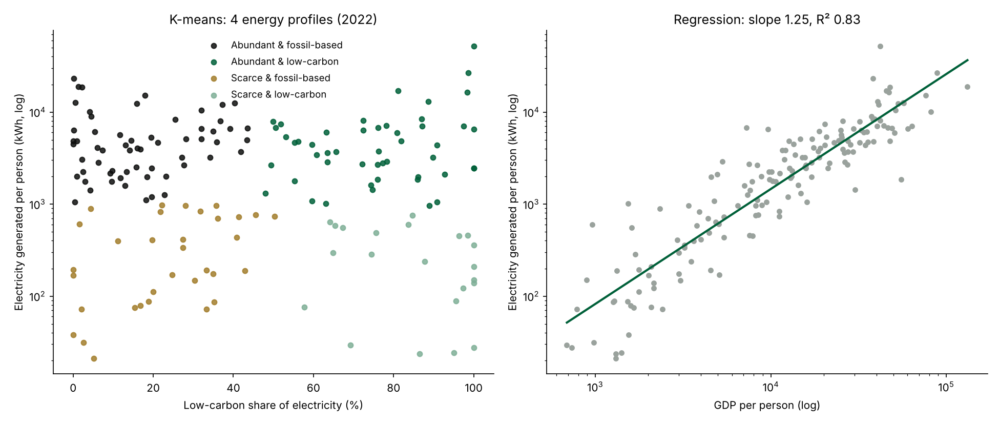

# Energy development profiles

**Which countries share the same energy development profile, and how closely does electricity track wealth?**

An analysis of 164 countries in 2022, using public data and two classic machine learning methods: k-means clustering and linear regression.



## Why this question

Energy is one of the basic conditions for development: no electricity means no connected schools, no cold chain for medicine, no digital economy. Energy is also a question of sovereignty. A country that generates its own low-carbon electricity depends less on imported fuel. This project looks at where countries stand today on both dimensions.

## Data

[Our World in Data, energy dataset](https://github.com/owid/energy-data), which compiles Ember, the Energy Institute Statistical Review of World Energy and the Maddison Project Database (GDP).

- **Year:** 2022, the latest year with GDP data for all countries in the set
- **Countries:** 164
- **Variables:**
  - electricity **generated** per person (kWh)
  - low-carbon share of electricity (renewables + nuclear, %)
  - GDP per person (inflation-adjusted)

## Method

**1. K-means clustering.** Each country is described by two features: electricity generated per person (on a log scale, because values range from about 20 to 50,000 kWh) and the low-carbon share of its electricity. Both are standardised so neither dominates. K-means is run for k = 2 to 7; **k = 4 gives the highest silhouette score (0.444)**, meaning the clearest separation between groups.

**2. Linear regression.** log10(electricity per person) is regressed on log10(GDP per person). On log scales, the slope reads as an elasticity: how many percent more electricity goes with 1% more income.

## Findings

**Four energy profiles**

| Profile | Countries | Median kWh per person | Median low-carbon share | Examples |
|---|---|---|---|---|
| Abundant & fossil-based | 60 | 4,432 | 15% | United States, Saudi Arabia, Australia, Mexico |
| Abundant & low-carbon | 49 | 3,755 | 76% | Norway, France, Sweden, Brazil, Canada |
| Scarce & fossil-based | 33 | 193 | 25% | Philippines, Pakistan, Nigeria, Ivory Coast |
| Scarce & low-carbon | 22 | 262 | 87% | Kenya, Ethiopia, Nepal, Cambodia |

The most striking group is **scarce & low-carbon**: countries whose electricity is already clean, mostly from hydropower, but where each person gets very little of it. A green energy mix is not the same as energy access. The challenge for these countries is volume, not the energy transition.

**Electricity follows wealth, closely**

- **Slope 1.25, R² 0.83:** 1% more GDP per person goes with about 1.25% more electricity per person, and income alone explains 83% of the differences between countries.
- **Above the line**, producing more than their income predicts: Mozambique, Laos and Paraguay, all large **exporters** of hydropower.
- **Below the line:** Luxembourg and Lithuania, which **import** much of their electricity, and Chad, Sierra Leone and Afghanistan, where access is severely limited.

## Limitations

- The data measures electricity **generated** in a country, not consumed. Exporters look higher and importers lower than their actual use; the regression outliers come largely from this.
- Two features keep the clustering easy to read, but leave out access rates, reliability (hours of supply per day) and prices.
- One year only. Correlation is not causation: wealth and electricity grow together, in both directions.

## Run it

```bash
pip install pandas numpy scikit-learn matplotlib
python analysis.py
```

It writes `summary.json`, `countries_with_profiles.csv` and `charts.png` next to the script.

---

Part of the Lab on [josephsbeiti.github.io](https://josephsbeiti.github.io) · Joseph Sbeiti
